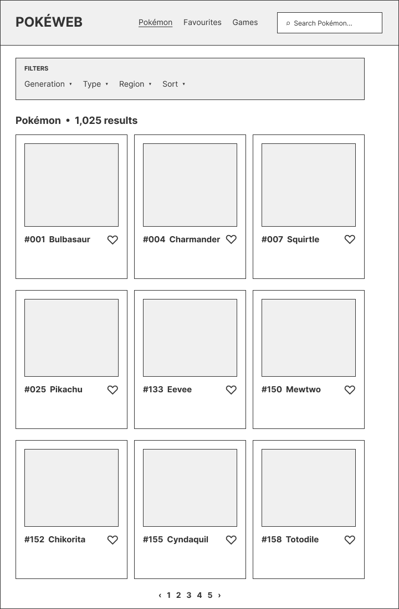
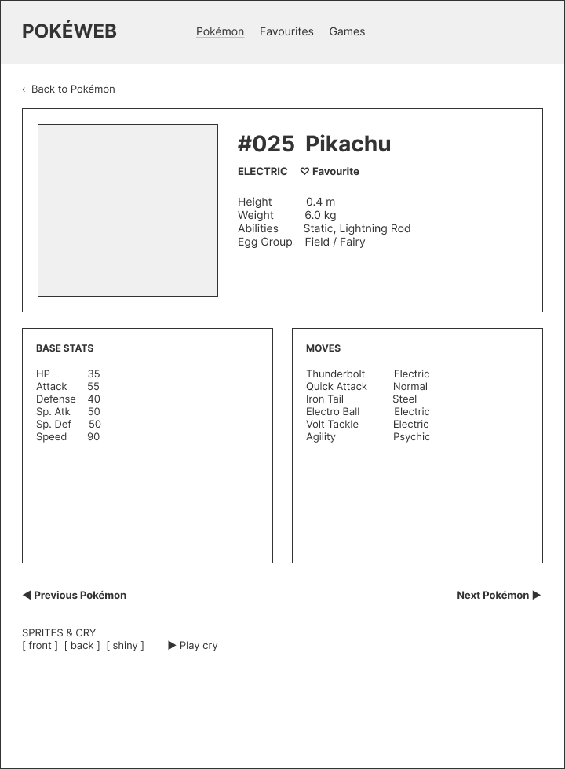
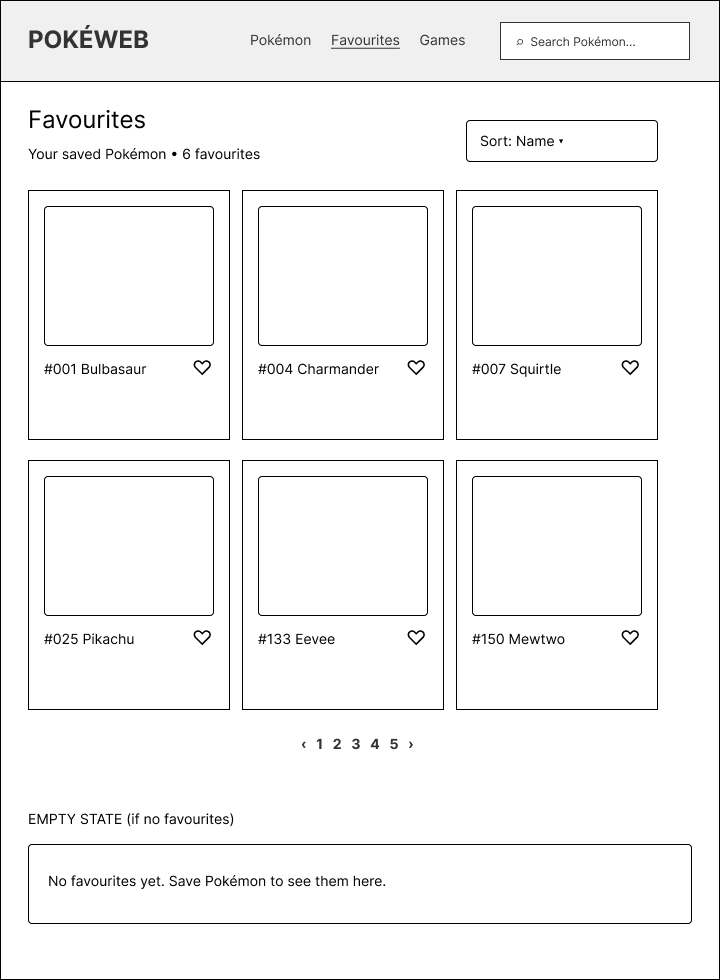
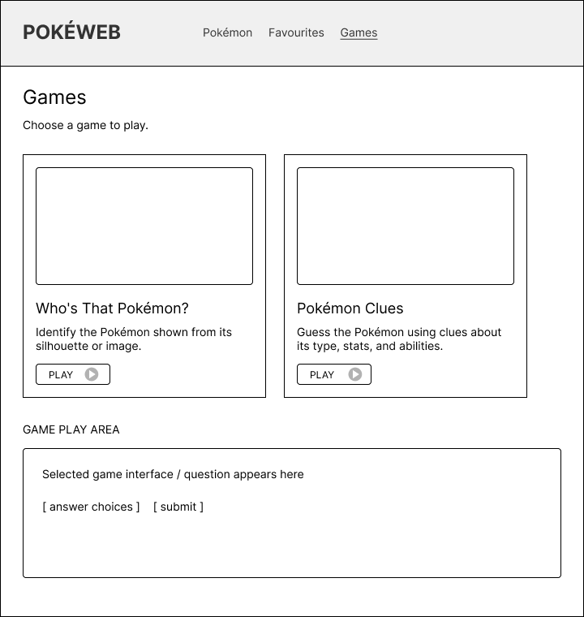

# PokéWeb Proposal: The Ultimate Digital Pokémon Encyclopedia

**Team Rocket**: Mason Shipton, Rayan Alam, Wingfung Hu, Aryan Kashe

## Topic

**PokéWeb** is an online, accessible encyclopedia designed for Pokémon fans, including both casual players and longtime enthusiasts of the franchise. This website allows users to explore detailed information about all 1,025 Pokémon, including their moves, abilities, types, egg groups, cries, and animated sprites from decades of beloved video games. Users can also filter Pokémon by generation, type, region, and more, or use the search bar to quickly find a particular Pokémon or category. Users can favourite Pokémon and access their information at any time, as well as play interactive games (Who's That Pokémon? and Pokémon Clues) that test and improve their Pokémon knowledge. By combining the depth of a traditional Pokémon database with a more modern, accessible, and interactive interface, PokéWeb aims to make exploring Pokémon information faster, easier, and more engaging!

## Data Source

**[PokéAPI](https://pokeapi.co/)** is a free, public REST API with no key required. We use `/pokemon/{id}` for core data and `/pokemon-species/{id}` for egg groups and generation.

Sample of the PokeAPI data shape (trimmed for fields that will be used)

    
GET https://pokeapi.co/api/v2/pokemon/ditto

    {
    "id": 132,
    "name": "ditto",
    "height": 3,
    "weight": 40,
    "abilities": [
        {
        "is_hidden": false,
        "slot": 1,
        "ability": {
            "name": "limber"
        }
        },
        {
        "is_hidden": true,
        "slot": 3,
        "ability": {
            "name": "imposter"
        }
        }
    ],
    "moves": [
        {
        "move": {
            "name": "transform"
        }
        }
    ],
    "species": {
        "name": "ditto",
        "url": "https://pokeapi.co/api/v2/pokemon-species/132/"
    },
    "sprites": {
        "other": {
        "official-artwork": {
            "front_shiny": "https://raw.githubusercontent.com/PokeAPI/sprites/master/sprites/pokemon/other/official-artwork/shiny/132.png",
            "front_default": "https://raw.githubusercontent.com/PokeAPI/sprites/master/sprites/pokemon/other/official-artwork/132.png"
        }
        },
        "versions": {
        "generation-iv": {
            "heartgold-soulsilver": {
            "back_shiny": "https://raw.githubusercontent.com/PokeAPI/sprites/master/sprites/pokemon/versions/generation-iv/heartgold-soulsilver/back/shiny/132.png",
            "back_female": null,
            "front_shiny": "https://raw.githubusercontent.com/PokeAPI/sprites/master/sprites/pokemon/versions/generation-iv/heartgold-soulsilver/shiny/132.png",
            "back_default": "https://raw.githubusercontent.com/PokeAPI/sprites/master/sprites/pokemon/versions/generation-iv/heartgold-soulsilver/back/132.png",
            "front_female": null,
            "front_default": "https://raw.githubusercontent.com/PokeAPI/sprites/master/sprites/pokemon/versions/generation-iv/heartgold-soulsilver/132.png",
            "back_shiny_female": null,
            "front_shiny_female": null
            }
        }
        }
    },
    "cries": {
        "latest": "https://raw.githubusercontent.com/PokeAPI/cries/main/cries/pokemon/latest/132.ogg"
    },
    "stats": [
        {
        "base_stat": 48,
        "stat": {
            "name": "hp"
        }
        },
        {
        "base_stat": 48,
        "stat": {
            "name": "attack"
        }
        },
        {
        "base_stat": 48,
        "stat": {
            "name": "defense"
        }
        },
        {
        "base_stat": 48,
        "stat": {
            "name": "special-attack"
        }
        },
        {
        "base_stat": 48,
        "stat": {
            "name": "special-defense"
        }
        },
        {
        "base_stat": 48,
        "stat": {
            "name": "speed"
        }
        }
    ],
    "types": [
        {
        "slot": 1,
        "type": {
            "name": "normal"
        }
        }
    ]
    }

    
GET https://pokeapi.co/api/v2/pokemon-species/ditto

    {
    "id": 132,
    "name": "ditto",
    "pokedex_numbers": [
        {
        "entry_number": 132,
        "pokedex": {
            "name": "national"
        }
        }
    ],
    "egg_groups": [
        {
        "name": "ditto"
        }
    ],
    "generation": {
        "name": "generation-i"
    }
    }

## Comparators

- [Pokémon Database](https://pokemondb.net/): Excellent user interface that is clean, fast, and intuitive. The website aggregates stats, movesets, and evolution lines into well-structured tables that are easy to read.
- [Serebii.net](https://www.serebii.net/): Operated almost entirely by [one person](https://www.polygon.com/pokemon-serebii-joe-merrick-interview/), the website is an exhaustive record of every game mechanic, event distribution, item location, and even anime episode. But, the website is quite old (created in 1999!), and the layout does not seem to have been updated since the early 2000s. The website is very dense, can be visually overwhelming, and difficult to navigate on mobile devices.
- [Bulbapedia](https://bulbapedia.bulbagarden.net/wiki/Main_Page): Wikipedia for Pokémon. The website focuses deeply on lore, etymology, historical trivia, anime synopsis, and manga appearances. Bulbapedia is the most in-depth Pokémon website. However, the website has a heavy ad load, slower page speeds, and the website's strict adherence to a wiki format does not allow for fast data filtering, degrading the user experience.

PokéWeb will display the same information as the three inspiration websites, and we intend on using Pokémon Database as a reference for our user interface, though our website will differ in a few key areas:
1. **API** - None of these websites use PokeAPI or any other Pokémon API. Instead, they either have their own proprietary custom databases (Pokémon Database and Serebii.net) or the data is entirely inputted and maintained by hundreds of contributors (Bulbapedia). Using PokeAPI will remove the need for our team to do data collection, maintenance, and handle the database server infrastructure. We can build a website that has the same data depth as our inspirations but in a fraction of the time, and which will enable our team to focus entirely on building the best frontend layout for the user experience and developing our other differentiating features.
2. **Games** - All three inspiration websites act as passive reference hubs for text and tables. PokéWeb will feature games that will test the user's knowledge of Pokémon designs, type, height, weight, ability, egg group, and more. Our website will provide a fun way for users to dive deeper into and learn more about the world of Pokémon.
3. **Favourites** - While Pokémon Database has a "Rate my Team" forum, none of the three inspiration websites include a favourite Pokémon system like PokéWeb will. This system will allow users to keep track of their chosen Pokémon and dive into their information fast, useful for building Pokémon teams in casual playthroughs or competitive play, especially now that there are over 1000 different Pokémon and 38 core series games.

## Scaled Feature Plan

Each member owns one vertical slice end to end (UI components, state, API calls, and tests), plus one half of a game (logic or UI).

| Member | Banner ID | User Name | Vertical Slice | Game Role | Team Role |
|---|---|---|---|---|---|
| Mason Shipton | 100910175 | Masonshipton25 | **Pokémon Favourites**: `FavouriteButton`, `useFavourites` hook, `/favourites` page, `localStorage` persistence | **Pokémon Clues** logic (`generateClues`, `useCluesGame`) | Project Manager (board upkeep, milestone tags, `AI-USAGE.md`) |
| Rayan Alam | 100908385 | Rayan-Alam-UOIT | **Pokémon Search and Filtering**: `SearchBar`, `FilterPanel`, search results, type/generation/region filters | **Who's That Pokémon?** UI (silhouette screen, reveal, feedback) | Styling Lead (cross-browser/responsive QA) |
| Wingfung Hu | 100922729 | WingfungHu | **Pokémon Browsing and Discovery**: main list, `PokemonCard`/`PokemonGrid`, navigation, sorting, pagination | **Pokémon Clues** UI (`ClueList`, shared `GuessInput`) | Repo & Deployment Lead (Vite, router, Netlify) |
| Aryan Kashefi-Aazam | 100878631 | Aryan-KA | **Pokémon Details**: `/pokemon/:id` with moves, abilities, types, egg groups, cries, sprites, height, weight | **Who's That Pokémon?** logic (`useWhosThatPokemon`, guess matching, scoring) | Testing Lead (W3C validation, PR testing) |

Team roles above are lead responsibilities, not exclusive ownership. Since every member is building a full vertical slice (UI, state, API calls, and tests), everyone touches a bit of everything, and no one is short on work. Things like accessibility are a shared responsibility across all slices, not just one person's job.

## Wireframes

Below are the low-fidelity wireframes for the four key pages of PokéWeb, which the static HTML and CSS pages for M1 are based on.

### List Page (Key Page #1)

### Detail Page (Key Page #2)

### Favourites Page (Key Page #3)

### Games Page (Key Page #4)
