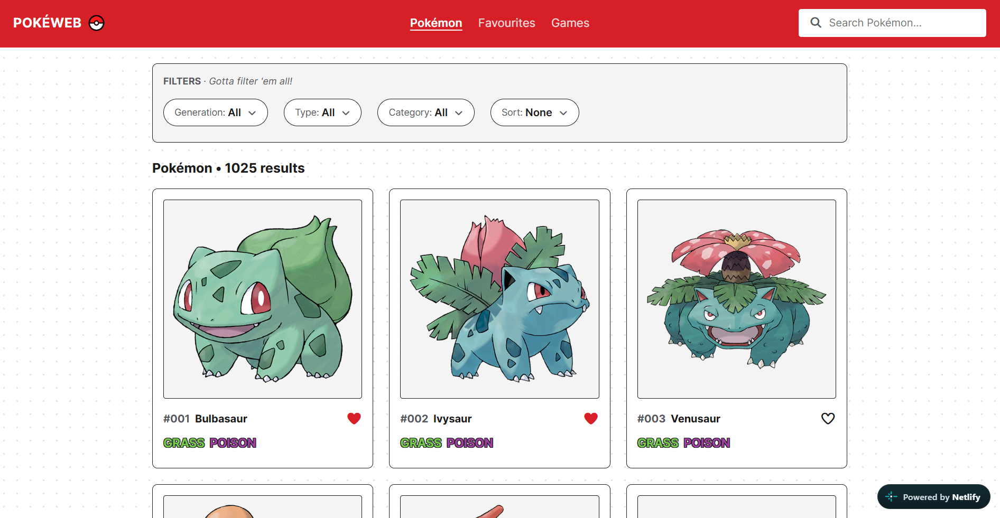
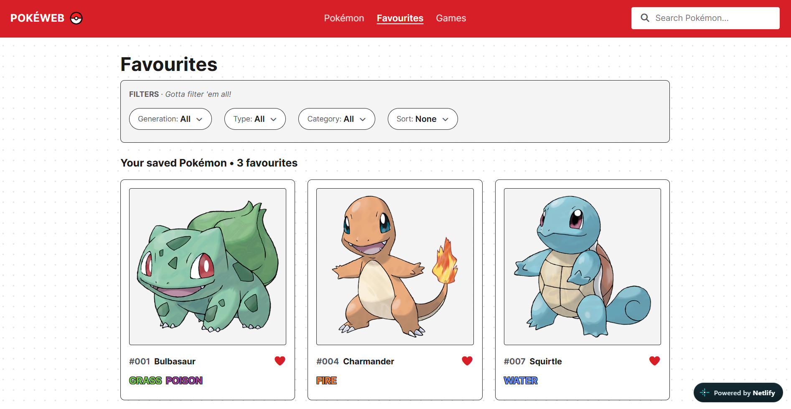
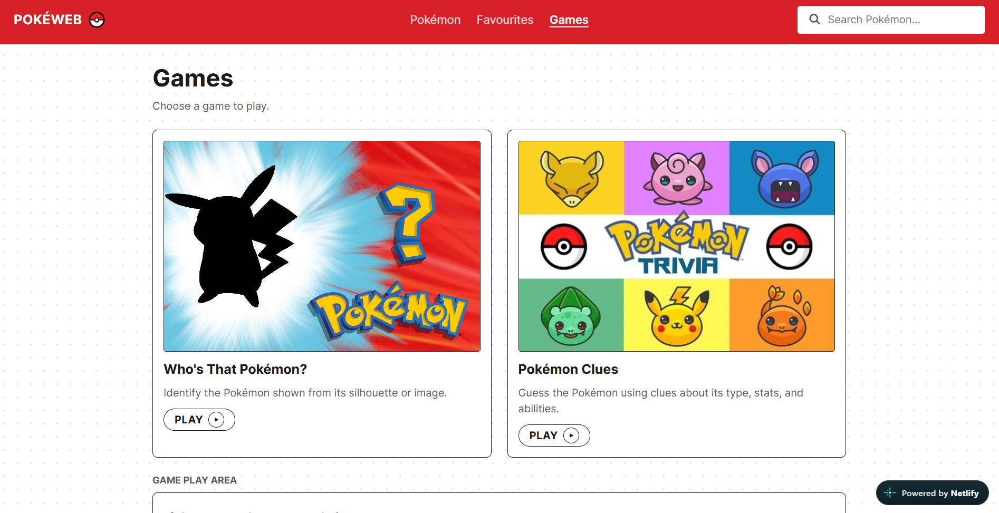

# PokéWeb: The Ultimate Digital Pokémon Encyclopedia


PokéWeb is an accessible online encyclopedia for Pokémon fans. Browse all
1,025 Pokémon, search and filter by type, generation, and region, save
favourites, and test your knowledge with two built-in games. Data comes
from [PokéAPI](https://pokeapi.co/).

## Deployment

**Visit the live website:** [PokéWeb: The Ultimate Digital Pokémon Encyclopedia](https://teamrocket-pokeweb.netlify.app/)

## Description

The website includes a catalog of every Pokémon, with a browsing page that offers filtering by generation, type, alphabetical order, and ID.



Each Pokémon has a details page showing physical measurements, base stats, moves, and more!


The browsing and details pages have a favourite button that saves Pokémon to the favourites page.



The browsing and favourites pages also include a "Search Pokémon" field for filtering by name.

The games page includes two games: `Pokémon Clues` and `Who's that Pokémon?`



## Project Structure

PokéWeb follows a component-based React architecture, separating pages, reusable UI components, application logic, and styling to keep the codebase organized and maintainable.

```text
csci3230u-web-dev-project/
├── css/                  # Page-specific and global stylesheets
├── public/
│   ├── images/           # Screenshots, images, and wireframes
│   └── _redirects        # Netlify routing configuration
├── src/
│   ├── components/       # Reusable UI components and component tests
│   │   └── selectForms/  # Custom dropdown and selection components
│   ├── constants/        # Shared configuration and fixed values
│   ├── context/          # Shared Pokémon data context
│   ├── hooks/            # Custom React hooks for application logic
│   ├── pages/            # Browse, Details, Favourites, and Games pages
│   ├── utils/            # Data transformation and helper functions
│   ├── test/             # Test setup and configuration
│   ├── App.jsx           # Application routes and layout
│   └── main.jsx          # React application entry point
├── AI-USAGE.md           # AI assistance documentation
├── package.json          # Dependencies and npm scripts
└── vite.config.js        # Vite and testing configuration
```

### Key Directories

- **`components/`** — Reusable interface elements such as Pokémon cards, filtering controls, pagination, and navigation.
- **`pages/`** — Main website pages, each responsible for displaying a specific section of PokéWeb.
- **`hooks/`** — Custom React hooks managing Pokémon fetching, filtering, pagination, favourites, evolution chains, and game logic.
- **`context/`** — Provides shared Pokémon data across components.
- **`utils/`** — Helper functions for processing PokéAPI responses and Pokémon information.
- **`constants/`** — Centralized configuration for filters, navigation, pagination, and game settings.
- **`css/`** — Global styling and individual page stylesheets.

### Data Flow

PokéWeb retrieves Pokémon information from **PokéAPI**, transforms API responses into a consistent format, and shares the data through React context. Pages use custom hooks to manage functionality such as searching, filtering, favourites, and navigation, while reusable components handle the user interface.

## Getting Started

You can use any terminal: Terminal on macOS/Linux, Command Prompt or PowerShell on Windows, or the built-in terminal in VS Code.

1. Install [Node.js](https://nodejs.org/en/download) (the LTS version is recommended) and [Git](https://git-scm.com/downloads), then confirm both work:
```bash
   node -v
   npm -v
   git --version
```
2. Clone the repository and move into the project folder:
```bash
   git clone https://github.com/Rayan-Alam-UOIT/csci3230u-web-dev-project.git
   cd csci3230u-web-dev-project
```
3. Install the project's dependencies. This creates a `node_modules` folder:
```bash
   npm install
```
4. Start the development server:
```bash
   npm run dev
```
5. Open the localhost link shown in your terminal in your browser.

## Testing

Run the project's component tests using Vitest:

```bash
npm test
```

To run a specific test file:

```bash
npm test -- src/components/PokemonCard.test.jsx
```

To check for code quality issues and potential errors using ESLint:

```bash
npm run lint
```

## Documentation

- [Project Proposal](PROPOSAL.md): Topic, data source, comparators,
  scaled feature plan, and wireframes
- [AI Usage](AI-USAGE.md): How AI tools were used in the development of PokéWeb

## Tech Stack

- HTML
- CSS
- React.js
- Vite
- JavaScript
- Node.js
- PokéAPI (Pokémon data)
- Vitest (Testing)
- Netlify (Deployment & Hosting)

## Team Rocket

| Member | GitHub | Focus |
|---|---|---|
| Mason Shipton | [Masonshipton25](https://github.com/Masonshipton25) | Favourites |
| Rayan Alam | [Rayan-Alam-UOIT](https://github.com/Rayan-Alam-UOIT) | Search & Filtering |
| Wingfung Hu | [WingfungHu](https://github.com/WingfungHu) | Browsing & Discovery |
| Aryan Kashefi-Aazam | [Aryan-KA](https://github.com/Aryan-KA) | Pokémon Details |

See the [Proposal](PROPOSAL.md#scaled-feature-plan) for full ownership
details.
