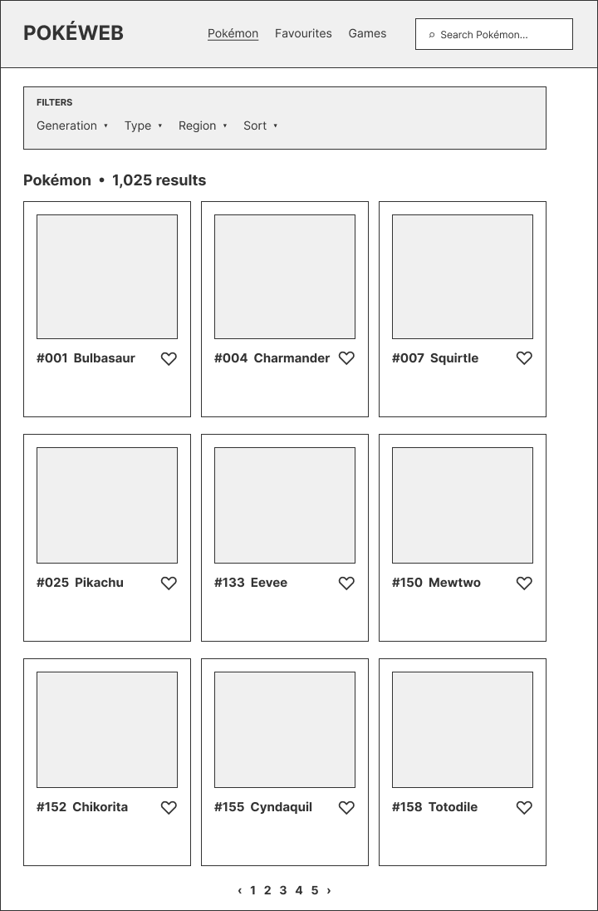

# **PokéWeb: The Ultimate Digital Pokemon Encyclopedia**

## Contents

+ [About](#about)
+ [Authors](#authors)
+ [API](#api)
+ [Wireframes](#wireframes)

## About

**PokéWeb** is an online, accessible encyclopedia designed for Pokemon fans, including both casual players and longtime enthusiasts of the franchise. This website allows users to explore detailed information about all 1,025 Pokemon, including their moves, abilities, types, egg groups, cries, and animated sprites from decades of beloved video games. Users can also filter Pokemon by generation, type, region, and more, or use the search bar to quickly find a particular Pokemon or category. Users can favourite Pokemon and access their information at any time, as well as play interactive games (Who's That Pokemon? and Pokemon Clues) that test and improve their Pokemon knowledge. By combining the depth of a traditional Pokemon database with a more modern, accessible, and interactive interface, PokéWeb aims to make exploring Pokemon information faster, easier, and more engaging!

Inspirations:
- [Pokemon Database](https://pokemondb.net/): Excellent user interface that is clean, fast, and intuitive. The website aggregates stats, movesets, and evolution lines into well-structured tables that are easy to read.
- [Serebii.net](https://www.serebii.net/): Operated almost entirely by [one person](https://www.polygon.com/pokemon-serebii-joe-merrick-interview/), the website is an exhaustive record of every game mechanic, event distribution, item location, and even anime episode. But, the website is quite old (created in 1999!), and the layout does not seem to have been updated since the early 2000s. The website is very dense, can be visually overwhelming, and difficult to navigate on mobile devices.
- [Bulbapedia](https://bulbapedia.bulbagarden.net/wiki/Main_Page): Wikipedia for Pokemon. The website focuses deeply on lore, etymology, historical trivia, anime synopsis, and manga appearances. Bulbapedia is the most in-depth Pokemon website. However, the website has a heavy ad load, slower page speeds, and the website's strict adherence to a wiki format does not allow for fast data filtering, degrading the user experience.

PokéWeb will display the same information as the three inspiration websites, and we intend on using Pokemon Database as a reference for our user interface, though our website will differ in a few key areas:
1. **API** - None of these websites use PokeAPI or any other Pokemon API. Instead, they either have their own proprietary custom databases (Pokemon Database and Serebii.net) or the data is entirely inputted and maintained by hundreds of contributors (Bulbapedia). Using PokeAPI will remove the need for our team to do data collection, maintenance, and handle the database server infrastructure. We can build a website that has the same data depth as our inspirations but in a fraction of the time, and which will enable our team to focus entirely on building the best frontend layout for the user experience and developing our other differentiating features.
2. **Games** - All three inspiration websites act as passive reference hubs for text and tables. PokéWeb will feature games that will test the user's knowledge of Pokemon designs, type, height, weight, ability, egg group, and more. Our website will provide a fun way for users to dive deeper into and learn more about the world of Pokemon.
3. **Favourites** - While Pokemon Database has a "Rate my Team" forum, none of the three inspiration websites include a favourite Pokemon system like PokéWeb will. This system will allow users to keep track of their chosen Pokemon and dive into their information fast, useful for building Pokemon teams in casual playthroughs or competitive play, especially now that there are over 1000 different Pokemon and 38 core series games.

## Authors

**Team Name**: Team Rocket

Each member owns one vertical slice end to end (UI components, state, API calls, and tests), plus one half of a game (logic or UI).

| Member | Banner ID | User Name | Vertical Slice | Game Role | Team Role |
|---|---|---|---|---|---|
| Mason Shipton | 100910175 | Masonshipton25 | **Pokemon Favourites**: `FavouriteButton`, `useFavourites` hook, `/favourites` page, `localStorage` persistence | **Pokemon Clues** logic (`generateClues`, `useCluesGame`) | Project Manager (board upkeep, milestone tags, `AI-USAGE.md`) |
| Rayan Alam | 100908385 | Rayan-Alam-UOIT | **Pokemon Search and Filtering**: `SearchBar`, `FilterPanel`, search results, type/generation/region filters | **Who's That Pokemon?** UI (silhouette screen, reveal, feedback) | Testing Lead |
| Wingfung Hu | 100922729 | WingfungHu | **Pokemon Browsing and Discovery**: main catalogue, `PokemonCard`/`PokemonGrid`, navigation, sorting, pagination | **Pokemon Clues** UI (`ClueList`, shared `GuessInput`) | Repo & Deployment Lead (Vite, router, Netlify) |
| Aryan Kashe | 100878631 | Aryan-KA | **Pokemon Details**: `/pokemon/:id` with moves, abilities, types, egg groups, cries, sprites, height, weight | **Who's That Pokemon?** logic (`useWhosThatPokemon`, guess matching, scoring) | Accessibility & Styling Lead |

## API

PokéWeb uses [PokeAPI](https://pokeapi.co/), a free and publicly available API containing comprehensive Pokemon data. We retrieve Pokemon information from the API to populate the website.

    
Sample of the PokeAPI Data Shape

  
    {
    "id": 132,
    "name": "ditto",
    "base_experience": 101,
    "height": 3,
    "is_default": true,
    "order": 214,
    "weight": 40,
    "abilities": [
        {
        "is_hidden": false,
        "slot": 1,
        "ability": {
            "name": "limber",
            "url": "https://pokeapi.co/api/v2/ability/7/"
        }
        },
        {
        "is_hidden": true,
        "slot": 3,
        "ability": {
            "name": "imposter",
            "url": "https://pokeapi.co/api/v2/ability/150/"
        }
        }
    ],
    "past_abilities": [
        {
        "generation": {
            "name": "generation-iv",
            "url": "https://pokeapi.co/api/v2/generation/4/"
        },
        "abilities": [
            {
            "is_hidden": true,
            "slot": 3,
            "ability": null
            }
        ]
        }
    ],
    "forms": [
        {
        "name": "ditto",
        "url": "https://pokeapi.co/api/v2/pokemon-form/132/"
        }
    ],
    "game_indices": [
        {
        "game_index": 76,
        "version": {
            "name": "red",
            "url": "https://pokeapi.co/api/v2/version/1/"
        }
        },
        {
        "game_index": 76,
        "version": {
            "name": "blue",
            "url": "https://pokeapi.co/api/v2/version/2/"
        }
        },
        {
        "game_index": 76,
        "version": {
            "name": "yellow",
            "url": "https://pokeapi.co/api/v2/version/3/"
        }
        },
        {
        "game_index": 132,
        "version": {
            "name": "gold",
            "url": "https://pokeapi.co/api/v2/version/4/"
        }
        },
        {
        "game_index": 132,
        "version": {
            "name": "silver",
            "url": "https://pokeapi.co/api/v2/version/5/"
        }
        },
        {
        "game_index": 132,
        "version": {
            "name": "crystal",
            "url": "https://pokeapi.co/api/v2/version/6/"
        }
        },
        {
        "game_index": 132,
        "version": {
            "name": "ruby",
            "url": "https://pokeapi.co/api/v2/version/7/"
        }
        },
        {
        "game_index": 132,
        "version": {
            "name": "sapphire",
            "url": "https://pokeapi.co/api/v2/version/8/"
        }
        },
        {
        "game_index": 132,
        "version": {
            "name": "emerald",
            "url": "https://pokeapi.co/api/v2/version/9/"
        }
        },
        {
        "game_index": 132,
        "version": {
            "name": "firered",
            "url": "https://pokeapi.co/api/v2/version/10/"
        }
        },
        {
        "game_index": 132,
        "version": {
            "name": "leafgreen",
            "url": "https://pokeapi.co/api/v2/version/11/"
        }
        },
        {
        "game_index": 132,
        "version": {
            "name": "diamond",
            "url": "https://pokeapi.co/api/v2/version/12/"
        }
        },
        {
        "game_index": 132,
        "version": {
            "name": "pearl",
            "url": "https://pokeapi.co/api/v2/version/13/"
        }
        },
        {
        "game_index": 132,
        "version": {
            "name": "platinum",
            "url": "https://pokeapi.co/api/v2/version/14/"
        }
        },
        {
        "game_index": 132,
        "version": {
            "name": "heartgold",
            "url": "https://pokeapi.co/api/v2/version/15/"
        }
        },
        {
        "game_index": 132,
        "version": {
            "name": "soulsilver",
            "url": "https://pokeapi.co/api/v2/version/16/"
        }
        },
        {
        "game_index": 132,
        "version": {
            "name": "black",
            "url": "https://pokeapi.co/api/v2/version/17/"
        }
        },
        {
        "game_index": 132,
        "version": {
            "name": "white",
            "url": "https://pokeapi.co/api/v2/version/18/"
        }
        },
        {
        "game_index": 132,
        "version": {
            "name": "black-2",
            "url": "https://pokeapi.co/api/v2/version/21/"
        }
        },
        {
        "game_index": 132,
        "version": {
            "name": "white-2",
            "url": "https://pokeapi.co/api/v2/version/22/"
        }
        },
        {
        "game_index": 132,
        "version": {
            "name": "x",
            "url": "https://pokeapi.co/api/v2/version/23/"
        }
        },
        {
        "game_index": 132,
        "version": {
            "name": "y",
            "url": "https://pokeapi.co/api/v2/version/24/"
        }
        },
        {
        "game_index": 132,
        "version": {
            "name": "omega-ruby",
            "url": "https://pokeapi.co/api/v2/version/25/"
        }
        },
        {
        "game_index": 132,
        "version": {
            "name": "alpha-sapphire",
            "url": "https://pokeapi.co/api/v2/version/26/"
        }
        },
        {
        "game_index": 132,
        "version": {
            "name": "sun",
            "url": "https://pokeapi.co/api/v2/version/27/"
        }
        },
        {
        "game_index": 132,
        "version": {
            "name": "moon",
            "url": "https://pokeapi.co/api/v2/version/28/"
        }
        },
        {
        "game_index": 132,
        "version": {
            "name": "ultra-sun",
            "url": "https://pokeapi.co/api/v2/version/29/"
        }
        },
        {
        "game_index": 132,
        "version": {
            "name": "ultra-moon",
            "url": "https://pokeapi.co/api/v2/version/30/"
        }
        },
        {
        "game_index": 132,
        "version": {
            "name": "lets-go-pikachu",
            "url": "https://pokeapi.co/api/v2/version/31/"
        }
        },
        {
        "game_index": 132,
        "version": {
            "name": "lets-go-eevee",
            "url": "https://pokeapi.co/api/v2/version/32/"
        }
        },
        {
        "game_index": 132,
        "version": {
            "name": "sword",
            "url": "https://pokeapi.co/api/v2/version/33/"
        }
        },
        {
        "game_index": 132,
        "version": {
            "name": "shield",
            "url": "https://pokeapi.co/api/v2/version/34/"
        }
        },
        {
        "game_index": 132,
        "version": {
            "name": "the-isle-of-armor-sword",
            "url": "https://pokeapi.co/api/v2/version/35/"
        }
        },
        {
        "game_index": 132,
        "version": {
            "name": "the-crown-tundra-sword",
            "url": "https://pokeapi.co/api/v2/version/36/"
        }
        },
        {
        "game_index": 132,
        "version": {
            "name": "brilliant-diamond",
            "url": "https://pokeapi.co/api/v2/version/37/"
        }
        },
        {
        "game_index": 132,
        "version": {
            "name": "shining-pearl",
            "url": "https://pokeapi.co/api/v2/version/38/"
        }
        },
        {
        "game_index": 132,
        "version": {
            "name": "legends-arceus",
            "url": "https://pokeapi.co/api/v2/version/39/"
        }
        },
        {
        "game_index": 132,
        "version": {
            "name": "scarlet",
            "url": "https://pokeapi.co/api/v2/version/40/"
        }
        },
        {
        "game_index": 132,
        "version": {
            "name": "violet",
            "url": "https://pokeapi.co/api/v2/version/41/"
        }
        },
        {
        "game_index": 132,
        "version": {
            "name": "the-teal-mask-scarlet",
            "url": "https://pokeapi.co/api/v2/version/42/"
        }
        },
        {
        "game_index": 132,
        "version": {
            "name": "the-indigo-disk-scarlet",
            "url": "https://pokeapi.co/api/v2/version/43/"
        }
        },
        {
        "game_index": 76,
        "version": {
            "name": "red-japan",
            "url": "https://pokeapi.co/api/v2/version/44/"
        }
        },
        {
        "game_index": 76,
        "version": {
            "name": "green-japan",
            "url": "https://pokeapi.co/api/v2/version/45/"
        }
        },
        {
        "game_index": 76,
        "version": {
            "name": "blue-japan",
            "url": "https://pokeapi.co/api/v2/version/46/"
        }
        },
        {
        "game_index": 132,
        "version": {
            "name": "legends-za",
            "url": "https://pokeapi.co/api/v2/version/47/"
        }
        },
        {
        "game_index": 132,
        "version": {
            "name": "mega-dimension",
            "url": "https://pokeapi.co/api/v2/version/48/"
        }
        }
    ],
    "held_items": [
        {
        "item": {
            "name": "metal-powder",
            "url": "https://pokeapi.co/api/v2/item/234/"
        },
        "version_details": [
            {
            "rarity": 5,
            "version": {
                "name": "ruby",
                "url": "https://pokeapi.co/api/v2/version/7/"
            }
            },
            {
            "rarity": 5,
            "version": {
                "name": "sapphire",
                "url": "https://pokeapi.co/api/v2/version/8/"
            }
            },
            {
            "rarity": 5,
            "version": {
                "name": "emerald",
                "url": "https://pokeapi.co/api/v2/version/9/"
            }
            },
            {
            "rarity": 5,
            "version": {
                "name": "firered",
                "url": "https://pokeapi.co/api/v2/version/10/"
            }
            },
            {
            "rarity": 5,
            "version": {
                "name": "leafgreen",
                "url": "https://pokeapi.co/api/v2/version/11/"
            }
            },
            {
            "rarity": 5,
            "version": {
                "name": "diamond",
                "url": "https://pokeapi.co/api/v2/version/12/"
            }
            },
            {
            "rarity": 5,
            "version": {
                "name": "pearl",
                "url": "https://pokeapi.co/api/v2/version/13/"
            }
            },
            {
            "rarity": 5,
            "version": {
                "name": "platinum",
                "url": "https://pokeapi.co/api/v2/version/14/"
            }
            },
            {
            "rarity": 5,
            "version": {
                "name": "heartgold",
                "url": "https://pokeapi.co/api/v2/version/15/"
            }
            },
            {
            "rarity": 5,
            "version": {
                "name": "soulsilver",
                "url": "https://pokeapi.co/api/v2/version/16/"
            }
            },
            {
            "rarity": 5,
            "version": {
                "name": "black",
                "url": "https://pokeapi.co/api/v2/version/17/"
            }
            },
            {
            "rarity": 5,
            "version": {
                "name": "white",
                "url": "https://pokeapi.co/api/v2/version/18/"
            }
            },
            {
            "rarity": 5,
            "version": {
                "name": "black-2",
                "url": "https://pokeapi.co/api/v2/version/21/"
            }
            },
            {
            "rarity": 5,
            "version": {
                "name": "white-2",
                "url": "https://pokeapi.co/api/v2/version/22/"
            }
            },
            {
            "rarity": 5,
            "version": {
                "name": "x",
                "url": "https://pokeapi.co/api/v2/version/23/"
            }
            },
            {
            "rarity": 5,
            "version": {
                "name": "y",
                "url": "https://pokeapi.co/api/v2/version/24/"
            }
            },
            {
            "rarity": 5,
            "version": {
                "name": "omega-ruby",
                "url": "https://pokeapi.co/api/v2/version/25/"
            }
            },
            {
            "rarity": 5,
            "version": {
                "name": "alpha-sapphire",
                "url": "https://pokeapi.co/api/v2/version/26/"
            }
            },
            {
            "rarity": 5,
            "version": {
                "name": "sun",
                "url": "https://pokeapi.co/api/v2/version/27/"
            }
            },
            {
            "rarity": 5,
            "version": {
                "name": "moon",
                "url": "https://pokeapi.co/api/v2/version/28/"
            }
            },
            {
            "rarity": 5,
            "version": {
                "name": "ultra-sun",
                "url": "https://pokeapi.co/api/v2/version/29/"
            }
            },
            {
            "rarity": 5,
            "version": {
                "name": "ultra-moon",
                "url": "https://pokeapi.co/api/v2/version/30/"
            }
            }
        ]
        },
        {
        "item": {
            "name": "quick-powder",
            "url": "https://pokeapi.co/api/v2/item/251/"
        },
        "version_details": [
            {
            "rarity": 50,
            "version": {
                "name": "diamond",
                "url": "https://pokeapi.co/api/v2/version/12/"
            }
            },
            {
            "rarity": 50,
            "version": {
                "name": "pearl",
                "url": "https://pokeapi.co/api/v2/version/13/"
            }
            },
            {
            "rarity": 50,
            "version": {
                "name": "platinum",
                "url": "https://pokeapi.co/api/v2/version/14/"
            }
            },
            {
            "rarity": 50,
            "version": {
                "name": "heartgold",
                "url": "https://pokeapi.co/api/v2/version/15/"
            }
            },
            {
            "rarity": 50,
            "version": {
                "name": "soulsilver",
                "url": "https://pokeapi.co/api/v2/version/16/"
            }
            },
            {
            "rarity": 50,
            "version": {
                "name": "black",
                "url": "https://pokeapi.co/api/v2/version/17/"
            }
            },
            {
            "rarity": 50,
            "version": {
                "name": "white",
                "url": "https://pokeapi.co/api/v2/version/18/"
            }
            },
            {
            "rarity": 50,
            "version": {
                "name": "black-2",
                "url": "https://pokeapi.co/api/v2/version/21/"
            }
            },
            {
            "rarity": 50,
            "version": {
                "name": "white-2",
                "url": "https://pokeapi.co/api/v2/version/22/"
            }
            },
            {
            "rarity": 50,
            "version": {
                "name": "x",
                "url": "https://pokeapi.co/api/v2/version/23/"
            }
            },
            {
            "rarity": 50,
            "version": {
                "name": "y",
                "url": "https://pokeapi.co/api/v2/version/24/"
            }
            },
            {
            "rarity": 50,
            "version": {
                "name": "omega-ruby",
                "url": "https://pokeapi.co/api/v2/version/25/"
            }
            },
            {
            "rarity": 50,
            "version": {
                "name": "alpha-sapphire",
                "url": "https://pokeapi.co/api/v2/version/26/"
            }
            },
            {
            "rarity": 50,
            "version": {
                "name": "sun",
                "url": "https://pokeapi.co/api/v2/version/27/"
            }
            },
            {
            "rarity": 50,
            "version": {
                "name": "moon",
                "url": "https://pokeapi.co/api/v2/version/28/"
            }
            },
            {
            "rarity": 50,
            "version": {
                "name": "ultra-sun",
                "url": "https://pokeapi.co/api/v2/version/29/"
            }
            },
            {
            "rarity": 50,
            "version": {
                "name": "ultra-moon",
                "url": "https://pokeapi.co/api/v2/version/30/"
            }
            }
        ]
        }
    ],
    "location_area_encounters": "https://pokeapi.co/api/v2/pokemon/132/encounters",
    "moves": [
        {
        "move": {
            "name": "transform",
            "url": "https://pokeapi.co/api/v2/move/144/"
        },
        "version_group_details": [
            {
            "level_learned_at": 1,
            "version_group": {
                "name": "red-blue",
                "url": "https://pokeapi.co/api/v2/version-group/1/"
            },
            "move_learn_method": {
                "name": "level-up",
                "url": "https://pokeapi.co/api/v2/move-learn-method/1/"
            },
            "order": null
            },
            {
            "level_learned_at": 1,
            "version_group": {
                "name": "yellow",
                "url": "https://pokeapi.co/api/v2/version-group/2/"
            },
            "move_learn_method": {
                "name": "level-up",
                "url": "https://pokeapi.co/api/v2/move-learn-method/1/"
            },
            "order": null
            },
            {
            "level_learned_at": 1,
            "version_group": {
                "name": "gold-silver",
                "url": "https://pokeapi.co/api/v2/version-group/3/"
            },
            "move_learn_method": {
                "name": "level-up",
                "url": "https://pokeapi.co/api/v2/move-learn-method/1/"
            },
            "order": null
            },
            {
            "level_learned_at": 1,
            "version_group": {
                "name": "crystal",
                "url": "https://pokeapi.co/api/v2/version-group/4/"
            },
            "move_learn_method": {
                "name": "level-up",
                "url": "https://pokeapi.co/api/v2/move-learn-method/1/"
            },
            "order": null
            },
            {
            "level_learned_at": 1,
            "version_group": {
                "name": "ruby-sapphire",
                "url": "https://pokeapi.co/api/v2/version-group/5/"
            },
            "move_learn_method": {
                "name": "level-up",
                "url": "https://pokeapi.co/api/v2/move-learn-method/1/"
            },
            "order": null
            },
            {
            "level_learned_at": 1,
            "version_group": {
                "name": "emerald",
                "url": "https://pokeapi.co/api/v2/version-group/6/"
            },
            "move_learn_method": {
                "name": "level-up",
                "url": "https://pokeapi.co/api/v2/move-learn-method/1/"
            },
            "order": null
            },
            {
            "level_learned_at": 1,
            "version_group": {
                "name": "firered-leafgreen",
                "url": "https://pokeapi.co/api/v2/version-group/7/"
            },
            "move_learn_method": {
                "name": "level-up",
                "url": "https://pokeapi.co/api/v2/move-learn-method/1/"
            },
            "order": null
            },
            {
            "level_learned_at": 1,
            "version_group": {
                "name": "diamond-pearl",
                "url": "https://pokeapi.co/api/v2/version-group/8/"
            },
            "move_learn_method": {
                "name": "level-up",
                "url": "https://pokeapi.co/api/v2/move-learn-method/1/"
            },
            "order": null
            },
            {
            "level_learned_at": 1,
            "version_group": {
                "name": "platinum",
                "url": "https://pokeapi.co/api/v2/version-group/9/"
            },
            "move_learn_method": {
                "name": "level-up",
                "url": "https://pokeapi.co/api/v2/move-learn-method/1/"
            },
            "order": null
            },
            {
            "level_learned_at": 1,
            "version_group": {
                "name": "heartgold-soulsilver",
                "url": "https://pokeapi.co/api/v2/version-group/10/"
            },
            "move_learn_method": {
                "name": "level-up",
                "url": "https://pokeapi.co/api/v2/move-learn-method/1/"
            },
            "order": null
            },
            {
            "level_learned_at": 1,
            "version_group": {
                "name": "black-white",
                "url": "https://pokeapi.co/api/v2/version-group/11/"
            },
            "move_learn_method": {
                "name": "level-up",
                "url": "https://pokeapi.co/api/v2/move-learn-method/1/"
            },
            "order": null
            },
            {
            "level_learned_at": 1,
            "version_group": {
                "name": "colosseum",
                "url": "https://pokeapi.co/api/v2/version-group/12/"
            },
            "move_learn_method": {
                "name": "level-up",
                "url": "https://pokeapi.co/api/v2/move-learn-method/1/"
            },
            "order": null
            },
            {
            "level_learned_at": 1,
            "version_group": {
                "name": "xd",
                "url": "https://pokeapi.co/api/v2/version-group/13/"
            },
            "move_learn_method": {
                "name": "level-up",
                "url": "https://pokeapi.co/api/v2/move-learn-method/1/"
            },
            "order": null
            },
            {
            "level_learned_at": 1,
            "version_group": {
                "name": "black-2-white-2",
                "url": "https://pokeapi.co/api/v2/version-group/14/"
            },
            "move_learn_method": {
                "name": "level-up",
                "url": "https://pokeapi.co/api/v2/move-learn-method/1/"
            },
            "order": null
            },
            {
            "level_learned_at": 1,
            "version_group": {
                "name": "x-y",
                "url": "https://pokeapi.co/api/v2/version-group/15/"
            },
            "move_learn_method": {
                "name": "level-up",
                "url": "https://pokeapi.co/api/v2/move-learn-method/1/"
            },
            "order": null
            },
            {
            "level_learned_at": 1,
            "version_group": {
                "name": "omega-ruby-alpha-sapphire",
                "url": "https://pokeapi.co/api/v2/version-group/16/"
            },
            "move_learn_method": {
                "name": "level-up",
                "url": "https://pokeapi.co/api/v2/move-learn-method/1/"
            },
            "order": null
            },
            {
            "level_learned_at": 1,
            "version_group": {
                "name": "sun-moon",
                "url": "https://pokeapi.co/api/v2/version-group/17/"
            },
            "move_learn_method": {
                "name": "level-up",
                "url": "https://pokeapi.co/api/v2/move-learn-method/1/"
            },
            "order": null
            },
            {
            "level_learned_at": 1,
            "version_group": {
                "name": "ultra-sun-ultra-moon",
                "url": "https://pokeapi.co/api/v2/version-group/18/"
            },
            "move_learn_method": {
                "name": "level-up",
                "url": "https://pokeapi.co/api/v2/move-learn-method/1/"
            },
            "order": null
            },
            {
            "level_learned_at": 1,
            "version_group": {
                "name": "lets-go-pikachu-lets-go-eevee",
                "url": "https://pokeapi.co/api/v2/version-group/19/"
            },
            "move_learn_method": {
                "name": "level-up",
                "url": "https://pokeapi.co/api/v2/move-learn-method/1/"
            },
            "order": null
            },
            {
            "level_learned_at": 1,
            "version_group": {
                "name": "sword-shield",
                "url": "https://pokeapi.co/api/v2/version-group/20/"
            },
            "move_learn_method": {
                "name": "level-up",
                "url": "https://pokeapi.co/api/v2/move-learn-method/1/"
            },
            "order": null
            },
            {
            "level_learned_at": 1,
            "version_group": {
                "name": "brilliant-diamond-shining-pearl",
                "url": "https://pokeapi.co/api/v2/version-group/23/"
            },
            "move_learn_method": {
                "name": "level-up",
                "url": "https://pokeapi.co/api/v2/move-learn-method/1/"
            },
            "order": null
            },
            {
            "level_learned_at": 1,
            "version_group": {
                "name": "scarlet-violet",
                "url": "https://pokeapi.co/api/v2/version-group/25/"
            },
            "move_learn_method": {
                "name": "level-up",
                "url": "https://pokeapi.co/api/v2/move-learn-method/1/"
            },
            "order": null
            },
            {
            "level_learned_at": 1,
            "version_group": {
                "name": "red-green-japan",
                "url": "https://pokeapi.co/api/v2/version-group/28/"
            },
            "move_learn_method": {
                "name": "level-up",
                "url": "https://pokeapi.co/api/v2/move-learn-method/1/"
            },
            "order": null
            },
            {
            "level_learned_at": 1,
            "version_group": {
                "name": "blue-japan",
                "url": "https://pokeapi.co/api/v2/version-group/29/"
            },
            "move_learn_method": {
                "name": "level-up",
                "url": "https://pokeapi.co/api/v2/move-learn-method/1/"
            },
            "order": null
            },
            {
            "level_learned_at": 0,
            "version_group": {
                "name": "champions",
                "url": "https://pokeapi.co/api/v2/version-group/32/"
            },
            "move_learn_method": {
                "name": "train",
                "url": "https://pokeapi.co/api/v2/move-learn-method/12/"
            },
            "order": null
            }
        ]
        }
    ],
    "species": {
        "name": "ditto",
        "url": "https://pokeapi.co/api/v2/pokemon-species/132/"
    },
    "sprites": {
        "other": {
        "home": {
            "front_shiny": "https://raw.githubusercontent.com/PokeAPI/sprites/master/sprites/pokemon/other/home/shiny/132.png",
            "front_female": null,
            "front_default": "https://raw.githubusercontent.com/PokeAPI/sprites/master/sprites/pokemon/other/home/132.png",
            "front_shiny_female": null
        },
        "showdown": {
            "back_shiny": "https://raw.githubusercontent.com/PokeAPI/sprites/master/sprites/pokemon/other/showdown/back/shiny/132.gif",
            "back_female": null,
            "front_shiny": "https://raw.githubusercontent.com/PokeAPI/sprites/master/sprites/pokemon/other/showdown/shiny/132.gif",
            "back_default": "https://raw.githubusercontent.com/PokeAPI/sprites/master/sprites/pokemon/other/showdown/back/132.gif",
            "front_female": null,
            "front_default": "https://raw.githubusercontent.com/PokeAPI/sprites/master/sprites/pokemon/other/showdown/132.gif",
            "back_shiny_female": null,
            "front_shiny_female": null
        },
        "dream_world": {
            "front_female": null,
            "front_default": "https://raw.githubusercontent.com/PokeAPI/sprites/master/sprites/pokemon/other/dream-world/132.svg"
        },
        "official-artwork": {
            "front_shiny": "https://raw.githubusercontent.com/PokeAPI/sprites/master/sprites/pokemon/other/official-artwork/shiny/132.png",
            "front_default": "https://raw.githubusercontent.com/PokeAPI/sprites/master/sprites/pokemon/other/official-artwork/132.png"
        }
        },
        "versions": {
        "generation-i": {
            "yellow": {
            "back_gray": "https://raw.githubusercontent.com/PokeAPI/sprites/master/sprites/pokemon/versions/generation-i/yellow/back/gray/132.png",
            "front_gray": "https://raw.githubusercontent.com/PokeAPI/sprites/master/sprites/pokemon/versions/generation-i/yellow/gray/132.png",
            "back_default": "https://raw.githubusercontent.com/PokeAPI/sprites/master/sprites/pokemon/versions/generation-i/yellow/back/132.png",
            "front_default": "https://raw.githubusercontent.com/PokeAPI/sprites/master/sprites/pokemon/versions/generation-i/yellow/132.png",
            "back_transparent": "https://raw.githubusercontent.com/PokeAPI/sprites/master/sprites/pokemon/versions/generation-i/yellow/transparent/back/132.png",
            "front_transparent": "https://raw.githubusercontent.com/PokeAPI/sprites/master/sprites/pokemon/versions/generation-i/yellow/transparent/132.png"
            },
            "red-blue": {
            "back_gray": "https://raw.githubusercontent.com/PokeAPI/sprites/master/sprites/pokemon/versions/generation-i/red-blue/back/gray/132.png",
            "front_gray": "https://raw.githubusercontent.com/PokeAPI/sprites/master/sprites/pokemon/versions/generation-i/red-blue/gray/132.png",
            "back_default": "https://raw.githubusercontent.com/PokeAPI/sprites/master/sprites/pokemon/versions/generation-i/red-blue/back/132.png",
            "front_default": "https://raw.githubusercontent.com/PokeAPI/sprites/master/sprites/pokemon/versions/generation-i/red-blue/132.png",
            "back_transparent": "https://raw.githubusercontent.com/PokeAPI/sprites/master/sprites/pokemon/versions/generation-i/red-blue/transparent/back/132.png",
            "front_transparent": "https://raw.githubusercontent.com/PokeAPI/sprites/master/sprites/pokemon/versions/generation-i/red-blue/transparent/132.png"
            }
        },
        "generation-v": {
            "icons": {
            "animated": {
                "front_default": "https://raw.githubusercontent.com/PokeAPI/sprites/master/sprites/pokemon/versions/generation-v/icons/animated/132.png"
            },
            "front_default": "https://raw.githubusercontent.com/PokeAPI/sprites/master/sprites/pokemon/versions/generation-v/icons/132.png"
            },
            "black-white": {
            "animated": {
                "back_shiny": "https://raw.githubusercontent.com/PokeAPI/sprites/master/sprites/pokemon/versions/generation-v/black-white/animated/back/shiny/132.gif",
                "back_female": null,
                "front_shiny": "https://raw.githubusercontent.com/PokeAPI/sprites/master/sprites/pokemon/versions/generation-v/black-white/animated/shiny/132.gif",
                "back_default": "https://raw.githubusercontent.com/PokeAPI/sprites/master/sprites/pokemon/versions/generation-v/black-white/animated/back/132.gif",
                "front_female": null,
                "front_default": "https://raw.githubusercontent.com/PokeAPI/sprites/master/sprites/pokemon/versions/generation-v/black-white/animated/132.gif",
                "back_shiny_female": null,
                "front_shiny_female": null
            },
            "back_shiny": "https://raw.githubusercontent.com/PokeAPI/sprites/master/sprites/pokemon/versions/generation-v/black-white/back/shiny/132.png",
            "back_female": null,
            "front_shiny": "https://raw.githubusercontent.com/PokeAPI/sprites/master/sprites/pokemon/versions/generation-v/black-white/shiny/132.png",
            "back_default": "https://raw.githubusercontent.com/PokeAPI/sprites/master/sprites/pokemon/versions/generation-v/black-white/back/132.png",
            "front_female": null,
            "front_default": "https://raw.githubusercontent.com/PokeAPI/sprites/master/sprites/pokemon/versions/generation-v/black-white/132.png",
            "back_shiny_female": null,
            "front_shiny_female": null
            }
        },
        "generation-ii": {
            "gold": {
            "back_shiny": "https://raw.githubusercontent.com/PokeAPI/sprites/master/sprites/pokemon/versions/generation-ii/gold/back/shiny/132.png",
            "front_shiny": "https://raw.githubusercontent.com/PokeAPI/sprites/master/sprites/pokemon/versions/generation-ii/gold/shiny/132.png",
            "back_default": "https://raw.githubusercontent.com/PokeAPI/sprites/master/sprites/pokemon/versions/generation-ii/gold/back/132.png",
            "front_default": "https://raw.githubusercontent.com/PokeAPI/sprites/master/sprites/pokemon/versions/generation-ii/gold/132.png",
            "front_transparent": "https://raw.githubusercontent.com/PokeAPI/sprites/master/sprites/pokemon/versions/generation-ii/gold/transparent/132.png"
            },
            "silver": {
            "back_shiny": "https://raw.githubusercontent.com/PokeAPI/sprites/master/sprites/pokemon/versions/generation-ii/silver/back/shiny/132.png",
            "front_shiny": "https://raw.githubusercontent.com/PokeAPI/sprites/master/sprites/pokemon/versions/generation-ii/silver/shiny/132.png",
            "back_default": "https://raw.githubusercontent.com/PokeAPI/sprites/master/sprites/pokemon/versions/generation-ii/silver/back/132.png",
            "front_default": "https://raw.githubusercontent.com/PokeAPI/sprites/master/sprites/pokemon/versions/generation-ii/silver/132.png",
            "front_transparent": "https://raw.githubusercontent.com/PokeAPI/sprites/master/sprites/pokemon/versions/generation-ii/silver/transparent/132.png"
            },
            "crystal": {
            "animated": {
                "front_shiny": "https://raw.githubusercontent.com/PokeAPI/sprites/master/sprites/pokemon/versions/generation-ii/crystal/animated/shiny/132.gif",
                "front_default": "https://raw.githubusercontent.com/PokeAPI/sprites/master/sprites/pokemon/versions/generation-ii/crystal/animated/132.gif"
            },
            "back_shiny": "https://raw.githubusercontent.com/PokeAPI/sprites/master/sprites/pokemon/versions/generation-ii/crystal/back/shiny/132.png",
            "front_shiny": "https://raw.githubusercontent.com/PokeAPI/sprites/master/sprites/pokemon/versions/generation-ii/crystal/shiny/132.png",
            "back_default": "https://raw.githubusercontent.com/PokeAPI/sprites/master/sprites/pokemon/versions/generation-ii/crystal/back/132.png",
            "front_default": "https://raw.githubusercontent.com/PokeAPI/sprites/master/sprites/pokemon/versions/generation-ii/crystal/132.png",
            "back_transparent": "https://raw.githubusercontent.com/PokeAPI/sprites/master/sprites/pokemon/versions/generation-ii/crystal/transparent/back/132.png",
            "front_transparent": "https://raw.githubusercontent.com/PokeAPI/sprites/master/sprites/pokemon/versions/generation-ii/crystal/transparent/132.png",
            "back_shiny_transparent": "https://raw.githubusercontent.com/PokeAPI/sprites/master/sprites/pokemon/versions/generation-ii/crystal/transparent/back/shiny/132.png",
            "front_shiny_transparent": "https://raw.githubusercontent.com/PokeAPI/sprites/master/sprites/pokemon/versions/generation-ii/crystal/transparent/shiny/132.png"
            }
        },
        "generation-iv": {
            "platinum": {
            "back_shiny": "https://raw.githubusercontent.com/PokeAPI/sprites/master/sprites/pokemon/versions/generation-iv/platinum/back/shiny/132.png",
            "back_female": null,
            "front_shiny": "https://raw.githubusercontent.com/PokeAPI/sprites/master/sprites/pokemon/versions/generation-iv/platinum/shiny/132.png",
            "back_default": "https://raw.githubusercontent.com/PokeAPI/sprites/master/sprites/pokemon/versions/generation-iv/platinum/back/132.png",
            "front_female": null,
            "front_default": "https://raw.githubusercontent.com/PokeAPI/sprites/master/sprites/pokemon/versions/generation-iv/platinum/132.png",
            "back_shiny_female": null,
            "front_shiny_female": null
            },
            "diamond-pearl": {
            "back_shiny": "https://raw.githubusercontent.com/PokeAPI/sprites/master/sprites/pokemon/versions/generation-iv/diamond-pearl/back/shiny/132.png",
            "back_female": null,
            "front_shiny": "https://raw.githubusercontent.com/PokeAPI/sprites/master/sprites/pokemon/versions/generation-iv/diamond-pearl/shiny/132.png",
            "back_default": "https://raw.githubusercontent.com/PokeAPI/sprites/master/sprites/pokemon/versions/generation-iv/diamond-pearl/back/132.png",
            "front_female": null,
            "front_default": "https://raw.githubusercontent.com/PokeAPI/sprites/master/sprites/pokemon/versions/generation-iv/diamond-pearl/132.png",
            "back_shiny_female": null,
            "front_shiny_female": null
            },
            "heartgold-soulsilver": {
            "back_shiny": "https://raw.githubusercontent.com/PokeAPI/sprites/master/sprites/pokemon/versions/generation-iv/heartgold-soulsilver/back/shiny/132.png",
            "back_female": null,
            "front_shiny": "https://raw.githubusercontent.com/PokeAPI/sprites/master/sprites/pokemon/versions/generation-iv/heartgold-soulsilver/shiny/132.png",
            "back_default": "https://raw.githubusercontent.com/PokeAPI/sprites/master/sprites/pokemon/versions/generation-iv/heartgold-soulsilver/back/132.png",
            "front_female": null,
            "front_default": "https://raw.githubusercontent.com/PokeAPI/sprites/master/sprites/pokemon/versions/generation-iv/heartgold-soulsilver/132.png",
            "back_shiny_female": null,
            "front_shiny_female": null
            }
        },
        "generation-ix": {
            "scarlet-violet": {
            "front_female": null,
            "front_default": "https://raw.githubusercontent.com/PokeAPI/sprites/master/sprites/pokemon/versions/generation-ix/scarlet-violet/132.png"
            }
        },
        "generation-vi": {
            "x-y": {
            "front_shiny": "https://raw.githubusercontent.com/PokeAPI/sprites/master/sprites/pokemon/versions/generation-vi/x-y/shiny/132.png",
            "front_female": null,
            "front_default": "https://raw.githubusercontent.com/PokeAPI/sprites/master/sprites/pokemon/versions/generation-vi/x-y/132.png",
            "front_shiny_female": null
            },
            "omegaruby-alphasapphire": {
            "front_shiny": "https://raw.githubusercontent.com/PokeAPI/sprites/master/sprites/pokemon/versions/generation-vi/omegaruby-alphasapphire/shiny/132.png",
            "front_female": null,
            "front_default": "https://raw.githubusercontent.com/PokeAPI/sprites/master/sprites/pokemon/versions/generation-vi/omegaruby-alphasapphire/132.png",
            "front_shiny_female": null
            }
        },
        "generation-iii": {
            "emerald": {
            "front_shiny": "https://raw.githubusercontent.com/PokeAPI/sprites/master/sprites/pokemon/versions/generation-iii/emerald/shiny/132.png",
            "front_default": "https://raw.githubusercontent.com/PokeAPI/sprites/master/sprites/pokemon/versions/generation-iii/emerald/132.png"
            },
            "ruby-sapphire": {
            "back_shiny": "https://raw.githubusercontent.com/PokeAPI/sprites/master/sprites/pokemon/versions/generation-iii/ruby-sapphire/back/shiny/132.png",
            "front_shiny": "https://raw.githubusercontent.com/PokeAPI/sprites/master/sprites/pokemon/versions/generation-iii/ruby-sapphire/shiny/132.png",
            "back_default": "https://raw.githubusercontent.com/PokeAPI/sprites/master/sprites/pokemon/versions/generation-iii/ruby-sapphire/back/132.png",
            "front_default": "https://raw.githubusercontent.com/PokeAPI/sprites/master/sprites/pokemon/versions/generation-iii/ruby-sapphire/132.png"
            },
            "firered-leafgreen": {
            "back_shiny": "https://raw.githubusercontent.com/PokeAPI/sprites/master/sprites/pokemon/versions/generation-iii/firered-leafgreen/back/shiny/132.png",
            "front_shiny": "https://raw.githubusercontent.com/PokeAPI/sprites/master/sprites/pokemon/versions/generation-iii/firered-leafgreen/shiny/132.png",
            "back_default": "https://raw.githubusercontent.com/PokeAPI/sprites/master/sprites/pokemon/versions/generation-iii/firered-leafgreen/back/132.png",
            "front_default": "https://raw.githubusercontent.com/PokeAPI/sprites/master/sprites/pokemon/versions/generation-iii/firered-leafgreen/132.png"
            }
        },
        "generation-vii": {
            "icons": {
            "front_female": null,
            "front_default": "https://raw.githubusercontent.com/PokeAPI/sprites/master/sprites/pokemon/versions/generation-vii/icons/132.png"
            },
            "ultra-sun-ultra-moon": {
            "front_shiny": "https://raw.githubusercontent.com/PokeAPI/sprites/master/sprites/pokemon/versions/generation-vii/ultra-sun-ultra-moon/shiny/132.png",
            "front_female": null,
            "front_default": "https://raw.githubusercontent.com/PokeAPI/sprites/master/sprites/pokemon/versions/generation-vii/ultra-sun-ultra-moon/132.png",
            "front_shiny_female": null
            }
        },
        "generation-viii": {
            "icons": {
            "front_female": null,
            "front_default": "https://raw.githubusercontent.com/PokeAPI/sprites/master/sprites/pokemon/versions/generation-viii/icons/132.png"
            },
            "brilliant-diamond-shining-pearl": {
            "front_female": null,
            "front_default": "https://raw.githubusercontent.com/PokeAPI/sprites/master/sprites/pokemon/versions/generation-viii/brilliant-diamond-shining-pearl/132.png"
            }
        }
        },
        "back_shiny": "https://raw.githubusercontent.com/PokeAPI/sprites/master/sprites/pokemon/back/shiny/132.png",
        "back_female": null,
        "front_shiny": "https://raw.githubusercontent.com/PokeAPI/sprites/master/sprites/pokemon/shiny/132.png",
        "back_default": "https://raw.githubusercontent.com/PokeAPI/sprites/master/sprites/pokemon/back/132.png",
        "front_female": null,
        "front_default": "https://raw.githubusercontent.com/PokeAPI/sprites/master/sprites/pokemon/132.png",
        "back_shiny_female": null,
        "front_shiny_female": null
    },
    "cries": {
        "latest": "https://raw.githubusercontent.com/PokeAPI/cries/main/cries/pokemon/latest/132.ogg",
        "legacy": "https://raw.githubusercontent.com/PokeAPI/cries/main/cries/pokemon/legacy/132.ogg"
    },
    "stats": [
        {
        "base_stat": 48,
        "effort": 1,
        "stat": {
            "name": "hp",
            "url": "https://pokeapi.co/api/v2/stat/1/"
        }
        },
        {
        "base_stat": 48,
        "effort": 0,
        "stat": {
            "name": "attack",
            "url": "https://pokeapi.co/api/v2/stat/2/"
        }
        },
        {
        "base_stat": 48,
        "effort": 0,
        "stat": {
            "name": "defense",
            "url": "https://pokeapi.co/api/v2/stat/3/"
        }
        },
        {
        "base_stat": 48,
        "effort": 0,
        "stat": {
            "name": "special-attack",
            "url": "https://pokeapi.co/api/v2/stat/4/"
        }
        },
        {
        "base_stat": 48,
        "effort": 0,
        "stat": {
            "name": "special-defense",
            "url": "https://pokeapi.co/api/v2/stat/5/"
        }
        },
        {
        "base_stat": 48,
        "effort": 0,
        "stat": {
            "name": "speed",
            "url": "https://pokeapi.co/api/v2/stat/6/"
        }
        }
    ],
    "past_stats": [
        {
        "generation": {
            "name": "generation-i",
            "url": "https://pokeapi.co/api/v2/generation/1/"
        },
        "stats": [
            {
            "base_stat": 48,
            "effort": 0,
            "stat": {
                "name": "special",
                "url": "https://pokeapi.co/api/v2/stat/9/"
            }
            }
        ]
        }
    ],
    "types": [
        {
        "slot": 1,
        "type": {
            "name": "normal",
            "url": "https://pokeapi.co/api/v2/type/1/"
        }
        }
    ],
    "past_types": []
    }
  

## Wireframes

Below are the low-fidelity wireframes for the key pages of PokéWeb, which our static HTML and CSS layouts are based on.

### Browse Page (Key Page #1)

### Detail Page (Key Page #2)
