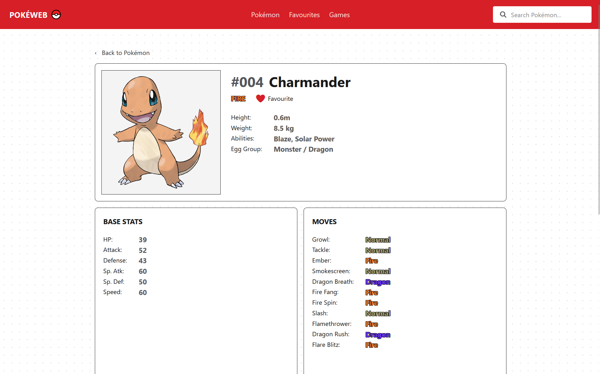

# PokéWeb: The Ultimate Digital Pokémon Encyclopedia


PokéWeb is an accessible online encyclopedia for Pokémon fans. Browse all
1,025 Pokémon, search and filter by type, generation, and region, save
favourites, and test your knowledge with two built-in games. Data comes
from [PokéAPI](https://pokeapi.co/).

## Description

The website includes a catalog of every Pokémon, with a browsing page that offers filtering by generation, type, alphabetical order, and ID.


Each Pokémon has a details page showing physical measurements, base stats, moves, and more.



The browsing and details pages have a favourite button that saves Pokémon to the favourites page.


The browsing and favourites pages also include a "Search Pokémon" field for filtering by name.

The games page includes two games: `Pokémon Clues` and `Who's that Pokémon?`


**Live site:** Netlify URL (To be added in M3)

## Getting Started

You can use any terminal: Terminal on macOS/Linux, Command Prompt or PowerShell on Windows, or the built-in terminal in VS Code.

1. Install [Node.js](https://nodejs.org/en/download) (the LTS version is recommended) and [Git](https://git-scm.com/downloads), then confirm both work:
```bash
   node -v
   npm -v
   git --version
```
2. Clone the repository and move into the project folder:
```bash
   git clone https://github.com/Rayan-Alam-UOIT/csci3230u-web-dev-project.git
   cd csci3230u-web-dev-project
```
3. Install the project's dependencies. This creates a `node_modules` folder:
```bash
   npm install
```
4. Start the development server:
```bash
   npm run dev
```
5. Open the localhost link shown in your terminal in your browser.

## Documentation

- [Project Proposal](PROPOSAL.md): Topic, data source, comparators,
  scaled feature plan, and wireframes
- [AI Usage](AI-USAGE.md): How AI tools were used in the development of PokéWeb

## Tech Stack

- HTML
- CSS
- PokéAPI
- React.js
- Vite
- JavaScript
- Node.js
- More to be added (M3 onward)

## Team Rocket

| Member | GitHub | Focus |
|---|---|---|
| Mason Shipton | [Masonshipton25](https://github.com/Masonshipton25) | Favourites |
| Rayan Alam | [Rayan-Alam-UOIT](https://github.com/Rayan-Alam-UOIT) | Search & Filtering |
| Wingfung Hu | [WingfungHu](https://github.com/WingfungHu) | Browsing & Discovery |
| Aryan Kashefi-Aazam | [Aryan-KA](https://github.com/Aryan-KA) | Pokémon Details |

See the [Proposal](PROPOSAL.md#scaled-feature-plan) for full ownership
details.
